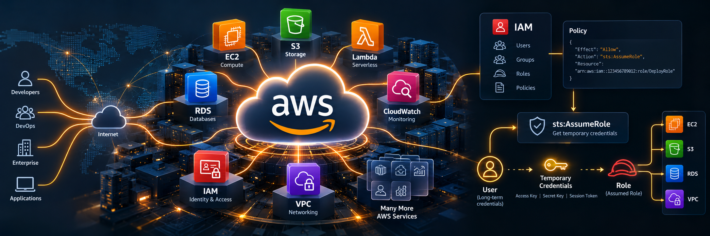

# AWS Services and IAM Actions Catalog
This PowerShell script builds a comprehensive, searchable catalog of **AWS services and their associated IAM actions (permissions)**, providing a convenient, consolidated reference for AWS access management. The output includes service names, service prefixes, ARN formats, and individual actions (such as `sts:AssumeRole`), along with their descriptions and access levels (List, Read, Write, Permissions Management, and Tagging). The script extracts information from AWSJavaScript assets, enriching it with AWS documentation, and scanning documentation for additional actions missing from the generator. Results are published in CSV, formatted text, and (soon) browsable HTML formats.

This catalog is particularly valuable to **AWS administrators, cloud architects, security engineers, DevOps teams, and IAM governance professionals** responsible for designing, reviewing, or troubleshooting access permissions. Having AWS actions consolidated into a readily searchable reference simplifies the development of IAM policies, roles, Service Control Policies (SCPs), and permissions boundaries. It also supports least-privilege security reviews, permission discovery, auditing, and identifying unfamiliar or newly introduced actions without having to navigate hundreds of individual AWS documentation pages. As the catalog is assembled from multiple AWS sources, completeness and accuracy depend on the availability and consistency of the underlying information.

The catalog is updated periodically and usually includes a DIFF (what is new, different, and obsoleted) from the previous time it was run. 

* [AwsServiceActions.md](AwsServiceActions.md) - List of AWS services and action in Markdown format (~7MB)
* [AwsServiceActions.csv](AwsServiceActions.csv) - List of AWS services and actions in CSV format (~7MB)
* [AwsServices.csv](AwsServices.csv) - List of AWS services only (~733KB)
* [AwsServices.txt](AwsServices.txt) - List of AWS Services as formatted text

## Example outputs

### AwsServices.txt
This is formatted text output that lists each Service Name, it's short name, and ARN format. For example:

```
ServiceName                         ServiceShortName          ARNFormat
Amazon S3                           s3                        arn:aws:s3:::${BucketName}/${KeyName}
AWS Security Token Service          sts                       arn:aws:iam::${Account}:${RelativeId}
AWS Server Migration Service        sms                       arn:aws:<serviceName>:<region>:<account-id>:<resource-type>/<resource_name>
```

### AwsServices.csv
This CSV lists all services with the full name, short name, all actions (as a bracketed list `[ ]`), the ARN format and it's RegEx, all condition keys (also bracketed `[ ]`), and the documentation link for the service.

EXAMPLE:

|**ServiceShortName**|**ServiceName**|**Actions**|**ARNFormat**|**ARNRegex**|**conditionKeys**|**HasResource**|**DocLink**|
|s3|Amazon S3|[AbortMultipartUpload;...]|arn:aws:s3:::${BucketName}/${KeyName}|^arn:aws:s3:::.+|[aws:RequestTag/${TagKey};...]|True|https://docs.aws.amazon.com/service-authorization/latest/reference/list_s3.html|
|sts|AWS Security Token Service|[AssumeRole;...]|arn:aws:iam::${Account}:${RelativeId}|^arn:aws:iam::.+|[cognito-identity.amazonaws.com:amr;...]|True|https://docs.aws.amazon.com/service-authorization/latest/reference/list_sts.html|
|sms|AWS Server Migration Service|[CreateApp;...]|arn:aws:<serviceName>:<region>:<account-id>:<resource-type>/<resource_name>|^arn:aws:<serviceName>:.+:.+:.+|null|False|https://docs.aws.amazon.com/service-authorization/latest/reference/list_sms.html|


### AwsServiceActions.csv
This lengthy CSV (over 7MB) consists of all services, their respective actions, the associated access level for the action, and two documentation links. 

EXAMPLE:

| **ServiceName** | **Action** | **Description** | **AccessLevel** | **Doc** | **Doc2** |
| --- | —— | ———– | ———– | — | —- |
| AWS Security Token Service | **sts:AssumeRole** | Grants permission to obtain a set of temporary security credentials that you can use to access AWS resources that you might not normally have access to | Write | [Doc](https://docs.aws.amazon.com/service-authorization/latest/reference/list_sts.html) | [Doc2](https://docs.aws.amazon.com/STS/latest/APIReference/API_AssumeRole.html) |
| AWS Security Token Service | **sts:AssumeRoleWithSAML** | Grants permission to obtain a set of temporary security credentials for users who have been authenticated via a SAML authentication response | Write | [Doc](https://docs.aws.amazon.com/service-authorization/latest/reference/list_sts.html) | [Doc2](https://docs.aws.amazon.com/STS/latest/APIReference/API_AssumeRoleWithSAML.html) |
| AWS Security Token Service | **sts:AssumeRoleWithWebIdentity** | Grants permission to obtain a set of temporary security credentials for users who have been authenticated in a mobile or web application with a web identity provider | Write | [Doc](https://docs.aws.amazon.com/service-authorization/latest/reference/list_sts.html) | [Doc2](https://docs.aws.amazon.com/STS/latest/APIReference/API_AssumeRoleWithWebIdentity.html) |
| ... | ... | ... | ... | ... |  ... |
| Amazon S3 | s3:AbortMultipartUpload | Grants permission to abort a multipart upload | Write | [Doc](https://docs.aws.amazon.com/service-authorization/latest/reference/list_s3.html) | [Doc2](https://docs.aws.amazon.com/AmazonS3/latest/API/API_AbortMultipartUpload.html) | 

## Notes
Comment lines in the CSV (including the header at the top) start with a hashtag (#).  The date
when the data was scraped along with the row count may be found at the bottom of each CSV.

Because AWS does not provide a single API for retrieving a complete catalog of services and operations, the script uses a *best-effort discovery process*, extracting information from JavaScript assets used by the [AWS Policy Generator](https://awspolicygen.s3.amazonaws.com/policygen.html). In addition, the respective documentation pages are also scraped for the description and access level information.
The documentation page is also scanned for any actions that may not appear in the javascript asset list.

The AWS documentation may be found at:
[https://docs.aws.amazon.com/IAM/latest/UserGuide/reference_policies_actions-resources-contextkeys.html](https://docs.aws.amazon.com/IAM/latest/UserGuide/reference_policies_actions-resources-contextkeys.html)

The list of AWS Policy Global Condition keys may be found at:
[https://docs.aws.amazon.com/IAM/latest/UserGuide/reference_policies_condition-keys.html#AvailableKeys](https://docs.aws.amazon.com/IAM/latest/UserGuide/reference_policies_condition-keys.html#AvailableKeys)

A similar script for Azure permissions may be found at:
[https://github.com/leswaters/AzureServices](https://github.com/leswaters/AzureServices)

## Anomalies
In scraping the data, a few anomalies have been observed with the original source data and/or documentation:

* The service shortname '**Ses**' appears twice: once for the '**Amazon Pinpoint Email Service**' and
again for '**Amazon SES**'.  This idosyncracy carries through to the IAM policy creator. 'ses:CreateConfigurationSet' appears several times as a result.

* Sometimes actions are not found in the corresponding documentation pages. This usually occurs when changes
are out of sync between the documentation and the input to the policy generator.
  These are noted in the CSV.

---
# Script
The data is generated using a PowerShell script which outputs the data for the two CSVs.
The code isn't fancy but it is functional. Enhancements & suggestions are welcomed!

### Script Parameters

* **-ServicesOnly**
  If indicated, then only the services are returned along with the top level documentation URL.
  Useful for getting a quick list of AWS services.

* **-RawDataOnly**
	If indicated, then the raw data from the JavaScript object is returned.  This is useful
	as it contains information about ARNs, associated RegEx, etc.
  
* **-ScanDocumentation**
	If indicated, then the documentation page is scanned for actions which did not
	appear in the AWS javascript scrape.  This is MUCH slower but yields more complete results.
  
* **-Extended**
	If indicated, returns extended information (WORK IN PROGRESS).
  
* **-AddNote**
	If indicated, then a note row is added to the structure as the first item (useful if piping to a CSV).
	
### Usage Examples

TO VIEW AWS SERVICES AND ACTIONS:

``.\Get-AwsServices.ps1 | Out-GridView``
	
TO GENERATE A CSV OF SERVICES AND ACTIONS:

``.\Get-AwsServices.ps1 -AddNote | Export-Csv -Path 'AwsServiceActions.csv' -force``
		
TO CONVERT ABOVE CSV TO FORMATTED TEXT:

``"{0,-56} {1,-80} {2,-23} {3}" -f 'ServiceName','Action','AccessLevel','Description' | out-file -FilePath 'AwsServiceActions.txt' -Encoding utf8 -force -width 210; Import-Csv -Path 'AwsServiceActions.csv' | foreach { ("{0,-56} {1,-80} {2,-23} {3}" -f $_.ServiceName, $_.Action, $_.AccessLevel, $_.Description) } | out-file -FilePath 'AwsServiceActions.txt' -width 210 -Encoding utf8 -Append``

TO GET A LIST OF SERVICES only AS A CSV:
``.\Get-AwsServices.ps1 -ServicesOnly | Export-Csv -Path 'AwsServices.csv' -Encoding utf8 -force``

TO VIEW A LIST OF SERVICES:

``.\Get-AwsServices.ps1 -ServicesOnly``
	
TO SEE A LIST OF ACTIONS FOR A SPECIFIC SERVICE:

``(.\Get-AwsServices.ps1 -RawDataOnly).ServiceMap."Amazon Redshift".Actions   # All Amazon Redshift actions``

### Next Steps
The next step is to put some automation around my script so that this repository is automatically
updated regularly or when any changes are detected. I also plan to start tracking additions & deletions
to the actions and mark them accordingly (handy to see what's new and what has been depricated).

Also, I would like to have the Resource Types, Condition Keys, and Dependent Actions included
in the actions CSV. It is possible to scrape this from the documentation page but this is a bit
more tedious, given the use of HTML column spans.

---
# References
* _Understanding AWS Policies_ - https://docs.aws.amazon.com/IAM/latest/UserGuide/access_policies_understand.html
